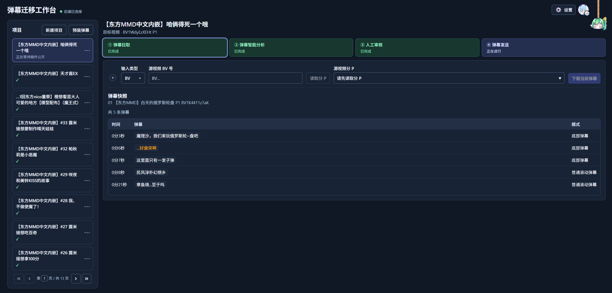
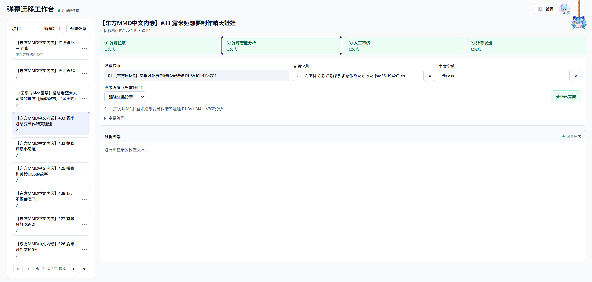
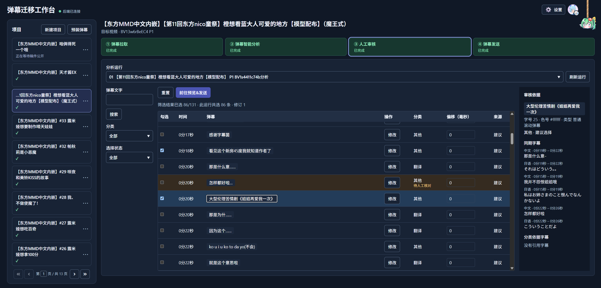
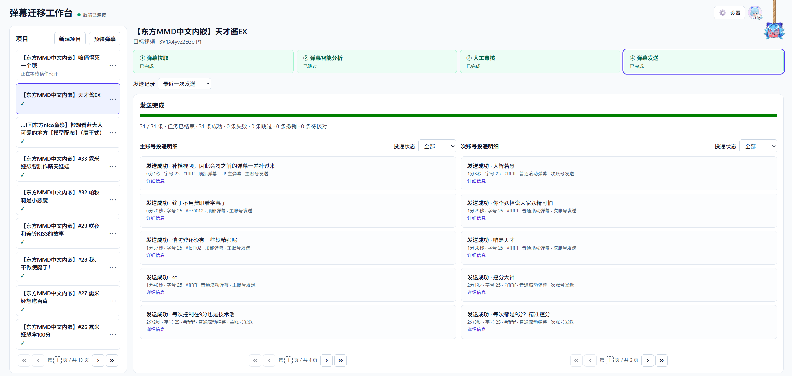

# B站弹幕迁移工作台

本项目面向东方MMD视频的弹幕迁移/搬运，功能为将过去的未经翻译/弹幕翻译MMD视频的弹幕，经过大语言模型分析或人工筛选删除翻译弹幕后，发送到新的同一MMD视频。业务流程见 [架构与 API 契约](docs/architecture.md) 和 [分阶段验收](docs/roadmap.md)。

## 界面预览

### 弹幕拉取


### 弹幕分析


### 弹幕审核


### 弹幕发送


## 使用方法人话版

1. 下载 Release 中的 zip 压缩包，然后解压。确保已经安装了 Python 3.12 或更高版本，使用 `py -0p` 看看有没有 3.12 及以上版本。如果没有安装，请前往 Python 官网下载安装。安装时建议勾选 "Add Python to PATH"；

2. 双击 `首次安装.cmd`，会尝试创建虚拟环境+下载依赖。默认使用官方 PyPI 源，失败则会尝试清华镜像；

3. 完事之后双击 `launch-windows.cmd` 会启动后端，并自动打开前端 UI；

4. 右上角点击登录，扫描二维码即可；

5. 点击设置，输入 deepseek 的 api 密钥后就可以进行 LLM 分析，根据你上传的中文/日语/双语字幕，识别翻译弹幕（目前仅支持 deepseek 的 flash 模型，思考强度可以自己选）；

6. 点击新建项目，输入你要填充弹幕的视频 BV 号，获取好分p后创建项目，按照步骤来即可；

7. 支持两个帐号一起发弹幕，理论上速度*2；

8. 没必要等1个视频的弹幕发完了再开始弄下一个，可以提前都准备好，任务会自己排队；

9. 如果你设置了稿件定时发送并且已经过审，预装弹幕可以让你提前把要发的弹幕准备好，在稿件公开的一刻会自动开始任务（也会检测后来有没有变更发布时间），现有任务会给这类任务让路（算是beta功能，稳定性有待长期验证）；

10. 高级弹幕也支持；

11. 退出程序：在之前双击 `launch-windows.cmd` 弹出的窗口中按 `Ctrl+C`；

12. 免责声明：使用的接口并非官方产物，稳定性不敢保证（叔叔阿姨哪天不高兴可能就端掉了）；llm分析会产生费用；用户应自行核对弹幕内容并遵守相应平台规则。

## Windows 发布包启动

解压发布包，先安装 Python 3.12 或更高版本（[官方下载](https://www.python.org/downloads/windows/)），然后双击 `首次安装.cmd`。脚本会创建虚拟环境，安装运行及 B 站功能所需的依赖；先使用 PyPI，失败后自动尝试清华镜像。安装需要联网。

安装完成后，双击 `launch-windows.cmd` 即可启动服务，并在工作台就绪后用默认浏览器打开 `http://127.0.0.1:8000`。服务在本机同时提供 UI 和 API，首次安装需要访问软件包仓库。数据默认保存在解压目录的 `data/`，可设置 `DANMAKU_DATA_DIR` 或传入 `--data-dir` 继续使用自己的数据目录。重启服务后浏览器自动建立本机会话。

启动脚本会先结束占用 8000 端口的旧工作台后端，等端口释放后再启动。其他程序占用端口时，脚本会报错退出。若旧后端正在发送，重启后中断的任务会暂停，正在投递且缺少回执的弹幕可能需要人工核对。

## 从源码开发

准备 Python 3.12+ 和 Node.js 22.12+。在项目根目录的 PowerShell 中运行以下命令。如果 Python 安装在自定义位置，可将首行的 `py -3.12` 替换为该解释器的绝对路径。

```powershell
py -3.12 -m venv .venv
.\.venv\Scripts\python.exe -m pip install -e "./backend[test]"
.\.venv\Scripts\python.exe -m uvicorn danmaku.main:create_app --factory --host 127.0.0.1 --port 8000 --no-proxy-headers --no-access-log
```

另开一个 PowerShell，从同一项目根目录启动前端。

```powershell
cd frontend
npm.cmd ci
npm.cmd run dev
```

浏览器访问 `http://127.0.0.1:5173`，页面自动建立本机会话。

工作台新建项目使用 B 站公开视频。若开发环境尚未安装 B 站依赖，运行以下命令并重启后端。

```powershell
.\.venv\Scripts\python.exe -m pip install -e "./backend[bilibili,test]"
```

新建项目时，输入目标视频 BV 号，读取并选择分 P。单分 P 视频默认使用视频标题，多分 P 视频使用 `目标视频标题 - 目标分 P 标题`。

在“弹幕拉取”输入源视频 BV 号并读取分 P，点击“下载当前弹幕”。下载完成后可滚动预览弹幕，也可以继续下载其他源视频。快照按完成顺序编号。存在多份原始快照时，可以将它们合并为一份新快照，例如“合并01+02”。合并保留重复弹幕，原始快照继续可用。所选分 P 的最大时长差超过 1 秒时，工作台会询问是否合并。

下载使用右上角登录的 B 站账号，未登录时使用匿名请求。关闭页面后任务继续运行。后端在下载途中重启时，可从上次提交的分段恢复。

## 分析弹幕

在“弹幕智能分析”选择弹幕快照，分别上传日语或中文字幕，每种语言可上传一份 ASS、SRT 或含 ASS/SRT 字幕的 TXT。至少上传一种语言后即可点击“开始分析”。SRT 和 TXT 在默认编码下会识别 UTF-16 BOM，也可以在上传前展开“字幕编码”选择其他编码。任务会一次提交所选字幕和全部弹幕。对于中文字幕中的 ASS 对白，纯文本及起止时间完全相同的台词只向模型提交第一条。

开始后，下方的“分析终端”显示 DeepSeek 实时返回的思考文本和输出 JSON。向上滚动可阅读前文，点击“回到底部”继续跟随。终端复用该次模型请求，文本暂存在后端内存中。关闭思考时和使用离线合成模型时，终端显示分类 JSON。

分析进行中，同一按钮会切换为“停止分析”。点击后取消排队或关闭正在接收的模型响应，终端保留已显示的文字并标记“已停止”。点击“重新分析”可用当前输入开始新一轮分析。

分析会核对同样式的固定弹幕是否连续对应多句中文字幕。提示词要求逐条识别同一句台词的不同译稿。有连续匹配的证据而模型仍判为普通“其他”时，条目会进入人工核对。

人工审核列表给“待人工核对”的整行显示琥珀色底色，点开可查看原因和对应字幕。普通“其他”弹幕默认勾选，包括“？？？”和“。。。”等纯标点。翻译、待人工核对、涉及字幕或翻译话题和未分类的条目默认不勾选。要用新版规则更新现有弹幕的分类，请重新分析并选择新运行。

重新上传字幕或改选快照后，可以用新的输入再次分析。每次分析保存为独立的结果，使用“弹幕快照名称分析”命名，历史结果可以在人工审核中选择。

首次配置前默认使用离线合成模型。打开右上角的“设置”，在左侧“弹幕LLM分析”中选择 DeepSeek 和 DeepSeek V4.1 Flash（`deepseek-flash`），填写 API 密钥并保存。思考默认开启，强度默认为高。可以关闭思考、调整强度或填写额外分析要求。已创建的运行保留提交时的模型配置和额外要求。Windows 密钥保存在当前用户的系统凭据库，界面仅显示掩码与保存状态。选择“删除密钥”后点击底部“保存”即可删除。更新同一端点的密钥后可恢复因凭据问题暂停的任务。

模型 API 请求出错时，分析区显示具体原因。连接超时、其他瞬态连接错误、限流或服务暂不可用时，按钮显示重试倒计时。每隔 10 秒自动重试，最多重试 3 次。

项目和任务默认保存在根目录的 `data/workbench.sqlite3`。可在启动后端前设置环境变量 `DANMAKU_DATA_DIR` 来指定数据目录。Vite 将 `/api` 代理到端口 8000，已实现的接口见 `http://127.0.0.1:8000/docs`。

## 通用设置

右上角的齿轮打开设置。左侧可切换弹幕 LLM 分析和弹幕投递，切换分类会保留草稿。底部“保存”一次提交所有已修改的分类。改回原值后，“保存”恢复灰化。退出时如有未保存的更改，可以选择保存后退出或直接退出。

## 登录 B 站

点击右上角“登录”，用哔哩哔哩手机 App 扫码并确认。登录成功后右上角显示头像，点击可退出。扫码取得的登录凭据和刷新令牌保存在当前 Windows 用户的系统凭据库，重启后自动复用。后端运行时会定期检查，并在 B 站要求时自动续期。已有手工录入的有效凭据仍可使用，扫码一次即可为该账号启用续期。B 站撤销登录或凭据失效且无法续期时，界面会提示重新扫码。

在「设置 → 弹幕投递」勾选「启用双账号投递」，点击「登录次账号」扫码，再保存设置。次账号头像会叠在主头像右下角，头像菜单可以分别注销两个账号。取消勾选并保存会隐藏次账号头像，保留次账号登录。次账号不可用或关闭双账号投递后，正在执行的双账号批次会改由主账号发送剩余弹幕，已发出的请求继续等待回执。双账号重新可用时，可确认把正在进行和排队的单账号批次切换到双账号。在途请求结算后，待发送弹幕会重新分配，投递明细和对应预览会显示新的发送账号。

## 投递弹幕

不同项目的分析任务可以并行，应用不设全局分析并发上限。每个项目同时处理一个分析任务，下载仍最多并行四个任务。切换项目或关闭页面后，已提交的任务在后台继续运行。

在“人工审核”完成勾选，点击“前往预览&发送”。真实投递要求项目有已解析的 B 站目标分 P，并已在右上角登录对应账号。核对预览中的 UID、目标 BV、分 P 和 CID，勾选确认后点击“确认并发送”。

发送所用快照和目标分 P 的时长差超过 1 秒时，工作台会在提交发送前询问是否继续。

投递默认按提交顺序逐批执行。每批结束后，下一批可立即开始，并遵守发送账号的冷却时间。已提交且仍在等待投递的项目卡片显示“投递排队中（位置/总数）”，位置和总数只统计正在等候投递的批次。队首处于冷却、退避或暂停状态时，后续批次默认继续等待。恢复队首后会从原进度继续。下载和分析可以在等待和投递期间继续执行。

队首正在发送、等待下次尝试或暂停时，排队批次可通过“暂停”左边的“插队发送”与它互换队列位置。若有弹幕在途，先等待该条确认成功或明确失败。交换后，原批次在新位置等待，并保留已保存的进度。原批次已暂停时，仍需手动恢复。当前请求产生未知回执或触发平台暂停时，取消待执行的交换。队首进入已暂停后，可以重新发起插队。

真实投递批次处理完仍有失败弹幕时，工作台会提示查看失败记录。选择“先重试失败弹幕”会保留队首并重试失败条目。选择“继续下一批”会结束本批、保留失败记录，并推进投递队列。已结束批次的失败重试排到队尾。

真实投递的回执、失败诊断和跳过原因可在任务明细中查阅。历史模拟账本仍可查看，升级时结束未完成的模拟任务。重启后，仍有待投递条目的批次需要手动恢复。投递中的未知回执会留在“待核对”，其余弹幕照常发送。发送完毕后，左侧项目显示“需人工核对”。查看目标播放器后，点击条目右侧的“人工确认”或“人工跳过”。“人工确认”会按插队规则优先安排同项目中排队的批次。

投递时，不支持的字号会改为 25 号，预览显示调整后的字号。

在“投递明细”的“待投递”分类中，可以逐条点击“撤销发送”。撤销和跳过一样计入已处理条数，批次可以正常完成，项目可以自动打勾。在“撤销”“已跳过”和“失败”分类中，点击条目右侧的“重新发送”并确认，该条会回到原批次的待投递队列。原位置已过时，等当前正在发送的条目处理完后，优先发送重发条目。原分类会保留条目并播放发送动画。若批次已暂停，确认重发也会恢复该批次。已有未知回执时，先完成核对。

真实投递每条结算后按设置的范围随机等待（默认 5–7 秒），同一 B 站 UID 的不同批次共享等待时间。限流后按设置等待重试（默认 3 分钟），并遵守较长的平台等待、条目间隔和账号冷却。修改设置影响之后计算的等待期限。连续三次明确限流或拒绝会触发至少 60 秒的账号冷却。同一条连续三次限流后先等至少 60 秒再尝试，第四次仍限流才记为失败。发送区显示实时进度条、已处理条数、失败、跳过、待核对及等待倒计时。

项目有真实投递且所有真实投递批次均无失败地结束后，项目名旁会自动显示绿色对勾。点击项目卡片右侧的三个点可重命名、删除或切换完成标记。有排队、运行、退避或正在暂停的任务时，需等任务结束或暂停后才可标记为完成。手动设置优先于自动判定，重启后仍有效。

## 构建 Windows 发布包

如需启用油库里拉绳，按设置页说明下载两份 PSD，放到 `frontend/public/yukkuri`，再双击同目录下的 `setup-yukkuri-assets.cmd`。源码和 Windows 发布包使用相同的素材路径，PSD 和导出的 PNG 由用户在本地准备。

在 `frontend` 执行 `npm.cmd ci` 和 `npm.cmd run build`，回到根目录运行 `.\.venv\Scripts\python.exe scripts\package_windows.py`。发布包生成在 `danmaku-workbench-windows.zip`，包含启动脚本、后端源码和已构建的 UI。

## 验证

```powershell
.\.venv\Scripts\python.exe -m pytest backend\tests
cd frontend
npm.cmd test
npm.cmd run build
```

测试使用临时 SQLite、合成任务、本地 HTTP 测试客户端及模拟 fetch 和 EventSource。首次安装依赖需要访问软件包仓库。合成流程无需 B 站账号或 LLM Key。

## 第三方组件与美术素材

本项目使用了以下第三方资源，版权归原作者所有。

### Pull Cord 交互组件

- **来源**：[Galactrex UI – Pull Cord](https://galactrex.com/ui/pull-cord/)
- **用途**：实现白天/夜间主题切换的交互式拉绳。
- **授权**：[Galactrex UI License](https://galactrex.com/ui/license/)

### 油库里角色素材

本项目使用由 **らの** 创作的「らの式立ち絵」系列素材作为拉绳头像，白天模式为琪露诺，夜间模式为大妖精。

出于版权考虑，**本项目不提供原始素材或生成后的 PNG 文件**，请用户自行下载：

- **琪露诺（ゆっくりチルノ）**：[下载 PSD](https://booth.pm/downloadables/5221454?variation_id=10373165)
- **大妖精（ゆっくり大妖精）**：[下载 PSD](https://booth.pm/downloadables/5221490?variation_id=10373209)

**安装方法：**

1. 将下载的 `ゆっくりチルノ.psd` 和 `ゆっくり大妖精.psd` 放入 `frontend\public\yukkuri` 文件夹。
2. 双击 `setup-yukkuri-assets.cmd`，脚本将自动安装临时依赖、提取 PNG 图层，并生成对应的角色文件夹。
3. 转换完成后，临时环境及依赖会自动清理。

运行脚本需要 Python 3.12 或更高版本，首次安装依赖需要联网。

**素材作者**：らの · [YouTube 频道](https://www.youtube.com/@rano-chan)

请遵守原作者的使用条款及《东方 Project》二次创作指南。本项目的许可证不适用于这些第三方资源。
